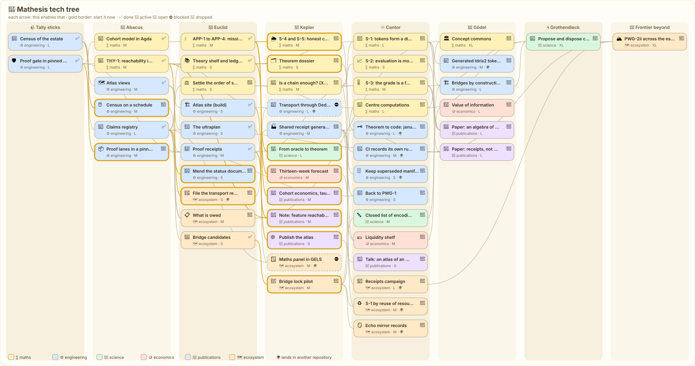

// SPDX-License-Identifier: CC-BY-SA-4.0
// GENERATED by scripts/ultraplan/ultraplan.mjs from docs/ultraplan/tree.jsonl,
// docs/ultraplan/advisors.jsonl and docs/ultraplan/expeditions.jsonl; do not hand-edit.
= Mathesis ultraplan: the tech tree
:toc: macro
:toclevels: 1

Each node is a capability. Its needs are the nodes it is built on, so the tree reads
like a civilisation game: one discovery enables the next. The data in
`docs/ultraplan/` is the source; this page and its picture are generated from it.
The era, the frontier, the forks, the confluences and each advisor's pick are derived,
never typed. A node marked done carries evidence the generator checks: a file, a
claim grade that the registry derives, or an accepted decision record. The value marks
are judgements, written down so they can be argued with.

Census of the tree: 12 done, 2 active (at most 3), 35 open, 3 blocked, 0 dropped, of 52 nodes. 12 can be started now.

toc::[]

Key: ✅ done · 🔨 active · 🌱 open · ⛔ blocked · 🍂 dropped. A gold border marks a node
that can be started now. Colours are tracks: ∑ maths · ⚙ engineering · 🔬 science · 🪙 economics · 📜 publications · 🗺 ecosystem.

== Research now: the frontier

These open nodes have every need done, so any of them can start today. "Unlocks"
counts the live nodes that depend on it, directly or through others.

[cols="3,1,1,1,5",options="header"]
|===
|Node |Track |Size |Unlocks |Summary
|xref:bridge-lock-pilot[🔗 Bridge lock pilot] |ecosystem |M |8 |The full bridge record for two pilots, a squeakwell ladder row and resource-algebra to tropical-types (WO 5.2, ruling D-7 a): what is claimed equal, by which map, checked how.
|xref:census-workflow[⏰ Census on a schedule] |engineering |M |2 |A scheduled census workflow as the one writer of the census rows (WO 5.3), so refreshes stop arriving by hand and unrecorded.
|xref:forecast-13wk[📅 Thirteen-week forecast] |economics |M |2 |A synthetic thirteen-week cash forecast on the proved cohort model (E-4.1), the first worked decision of the applied shelf.
|xref:s4-s5-verdict[🌦️ S-4 and S-5: honest cash verdicts] |maths |M |2 |A sound three-valued cash verdict over intervals, where missing means unbounded (S-4), and more uncertainty never strengthens a verdict (S-5). Reuses residual-evidence-types at a pin; pass is PWG-3 (E-4.2).
|xref:dossier[🗂️ Theorem dossier] |maths |S |1 |The eight-item dossier for each theorem (Line 0), scored first on THY-1, five januskey theorems and two each of secret-types and lintel (E-0). Its home (here or standards, R-5) is still open.
|xref:file-transport-bugs[🐛 File the transport reproducers] |ecosystem |S |1 |File the THY-1 reproducers upstream (E-2.4): the Agda2Dedukti crash and option gaps, and Lambdapi dropping rules. Filing is the owner's act. _(upstream:Deducteam/agda2dedukti)_
|xref:pinned-image[📦 Proof lanes in a pinned image] |engineering |M |1 |Run the three proof lanes in a container image pinned by digest, the condition PROOF-POLICY now sets for PWG-1 (standards#1625). The Guix shell alone does not qualify.
|xref:s2-monotone[📈 S-2: evaluation is monotone] |maths |S |1 |Positive evaluation of status is monotone. It holds for each ordered resource algebra, so it can be proved once against the kernel now, whatever X-PF1 decides (R-3).
|xref:doc-drift-fix[🧹 Mend the status documents] |engineering |S |0 |ROADMAP, PROOF-NEEDS, README and the intend contract contradict the receipts (PWG-1 vs PWG-2ii, receipts called planned that exist, stage states). Make each agree with the derived facts.
|xref:paper-thy1[📄 Note: feature reachability] |publications |M |0 |A short note on THY-1: why requesting every feature is a sound check for absence, with the three-prover receipt as artefact. Its dependant is a real standards rule.
|xref:statistical-bridge[🎲 From oracle to theorem] |science |L |0 |S-MN and S-DM (the multinomial logit closed form and the DM contrast limit) are tested only, against MetaManifold-WebUI as oracle. Prove them in Agda, Rocq and Lean for admission (Q-2.6).
|xref:teaching-cohort[📓 Cohort economics, taught] |publications |M |0 |A worked tutorial: a small business model where missing data stays missing, with the proofs alongside and synthetic data only.
|===

== The council

Each advisor asks one question of every node and names one pick from the frontier,
except the me advisor. It is private: its notes and its choice stay outside this
repository, and the page lists, unranked, the frontier nodes the owner has tagged.

=== ∑ Mathematician

_Asks:_ Is it true, is it new, and does it join two things that were apart?

_Pick:_ xref:bridge-lock-pilot[🔗 Bridge lock pilot]. Equivalence as identity, made checkable.

=== 🔬 Scientist

_Asks:_ What would we measure, and what result would change our mind?

_Pick:_ xref:statistical-bridge[🎲 From oracle to theorem]. Takes a statistical result that is only tested and makes it a theorem.

=== ⚙️ Engineer

_Asks:_ Does it run in the gate, fail loudly, and stay cheap to keep?

_Pick:_ xref:census-workflow[⏰ Census on a schedule].

=== 🪙 Economist

_Asks:_ What does it cost, what does it return, and who would fund or use it?

_Pick:_ xref:s4-s5-verdict[🌦️ S-4 and S-5: honest cash verdicts]. A forecast that can say undecided is worth more than one that guesses.

=== 📜 Publisher

_Asks:_ Is there a paper, a talk or a citable artefact here?

_Pick:_ xref:paper-thy1[📄 Note: feature reachability]. A complete, small, checked result: the easiest first paper.

=== 🔍 Soundness auditor

_Asks:_ Is every done backed by a receipt, and where is the hole?

_Pick:_ xref:pinned-image[📦 Proof lanes in a pinned image]. The only road back to PWG-1 for THY-1 and APP-1 to APP-4.

=== 🗺️ Estate cartographer

_Asks:_ Does another repository already have this, or need it? Converge rather than rebuild.

_Pick:_ xref:bridge-lock-pilot[🔗 Bridge lock pilot]. The first real convergence between repositories; everything cross-repo waits on it.

=== 🍎 Teacher

_Asks:_ Could a newcomer learn something true and useful from it?

_Pick:_ xref:teaching-cohort[📓 Cohort economics, taught]. Shows why a proof matters to someone who reads spreadsheets, not theorems.

=== 🃏 Contrarian

_Asks:_ What if we took the other road? Which cheap node is everyone overlooking?

_Pick:_ xref:file-transport-bugs[🐛 File the transport reproducers].

=== 🫶 Me

_Asks:_ Does it help the owner’s own life and work? Its notes are kept privately, outside this repository.

_No public pick:_ the owner chooses in a private panel of their own. Tagged on the frontier, in id order: xref:forecast-13wk[📅 Thirteen-week forecast], xref:paper-thy1[📄 Note: feature reachability], xref:teaching-cohort[📓 Cohort economics, taught].

== Forks and confluences

A fork enables nodes on two or more tracks: work there spreads. A confluence needs
nodes from two or more tracks: work there joins. Rivals are different routes to the
same place; the contrarian keeps the road not taken in view.

.Forks
* xref:app-proofs[💧 APP-1 to APP-4: missing stays missing] -> xref:forecast-13wk[📅 Thirteen-week forecast], xref:s4-s5-verdict[🌦️ S-4 and S-5: honest cash verdicts], xref:teaching-cohort[📓 Cohort economics, taught]
* xref:bridge-lock-pilot[🔗 Bridge lock pilot] -> xref:centre-computations[🎯 Centre computations], xref:echo-mirrors[🪞 Echo mirror records], xref:encoding-differences[🔤 Closed list of encoding differences], xref:s1-reuse[♻️ S-1 by reuse of resource-algebra]
* xref:centre-computations[🎯 Centre computations] -> xref:concept-commons[🏛️ Concept commons], xref:corpus[🧪 Propose and dispose corpus]
* xref:claims-registry[📒 Claims registry] -> xref:bridge-candidates[🌉 Bridge candidates], xref:chain-question[🧩 Is a chain enough? (X-PF1)], xref:doc-drift-fix[🧹 Mend the status documents], xref:maths-panel[🪟 Maths panel for the estate], xref:paper-receipts[📰 Paper: receipts, not claims], xref:receipts[🔏 Proof receipts], xref:theory-shelf[📚 Theory shelf and ledger], xref:whats-owed[📋 What is owed]
* xref:proof-gate[🛡️ Proof gate in pinned Guix] -> xref:cohort-model[👥 Cohort model in Agda], xref:pinned-image[📦 Proof lanes in a pinned image], xref:receipts[🔏 Proof receipts], xref:thy1[🧭 THY-1: reachability is monotone]
* xref:receipt-generator[🏭 Shared receipt generator] -> xref:ci-recorder[🤖 CI records its own runs], xref:paper-receipts[📰 Paper: receipts, not claims], xref:pwg1-regained[🥇 Back to PWG-1], xref:receipts-campaign[📣 Receipts campaign], xref:superseded-manifests-option[🗄️ Keep superseded manifests (option)]
* xref:receipts[🔏 Proof receipts] -> xref:paper-thy1[📄 Note: feature reachability], xref:receipt-generator[🏭 Shared receipt generator], xref:s3-grade-function[🎚️ S-3: the grade is a function]
* xref:s1-token-algebra[🔢 S-1: tokens form a dioid] -> xref:bridge-by-construction[🏗 Bridges by construction], xref:idris-token-laws[🧬 Generated Idris2 token laws], xref:paper-status-algebra[📘 Paper: an algebra of proof status]
* xref:s3-grade-function[🎚️ S-3: the grade is a function] -> xref:corpus[🧪 Propose and dispose corpus], xref:paper-receipts[📰 Paper: receipts, not claims], xref:paper-status-algebra[📘 Paper: an algebra of proof status]
* xref:theory-shelf[📚 Theory shelf and ledger] -> xref:dossier[🗂️ Theorem dossier], xref:s1-token-algebra[🔢 S-1: tokens form a dioid], xref:s2-monotone[📈 S-2: evaluation is monotone], xref:statistical-bridge[🎲 From oracle to theorem]
* xref:thy1[🧭 THY-1: reachability is monotone] -> xref:dedukti-transport[🚂 Transport through Dedukti], xref:file-transport-bugs[🐛 File the transport reproducers], xref:paper-thy1[📄 Note: feature reachability], xref:theory-shelf[📚 Theory shelf and ledger]
* xref:token-order[⚖️ Settle the order of status tokens] -> xref:centre-computations[🎯 Centre computations], xref:s1-reuse[♻️ S-1 by reuse of resource-algebra], xref:s1-token-algebra[🔢 S-1: tokens form a dioid], xref:s3-grade-function[🎚️ S-3: the grade is a function]

.Confluences
* xref:encoding-differences[🔤 Closed list of encoding differences] + xref:s1-token-algebra[🔢 S-1: tokens form a dioid] -> xref:bridge-by-construction[🏗 Bridges by construction]
* xref:bridge-lock-pilot[🔗 Bridge lock pilot] + xref:token-order[⚖️ Settle the order of status tokens] -> xref:centre-computations[🎯 Centre computations]
* xref:centre-computations[🎯 Centre computations] + xref:whats-owed[📋 What is owed] -> xref:concept-commons[🏛️ Concept commons]
* xref:bridge-by-construction[🏗 Bridges by construction] + xref:centre-computations[🎯 Centre computations] + xref:s3-grade-function[🎚️ S-3: the grade is a function] -> xref:corpus[🧪 Propose and dispose corpus]
* xref:thy1[🧭 THY-1: reachability is monotone] + xref:file-transport-bugs[🐛 File the transport reproducers] -> xref:dedukti-transport[🚂 Transport through Dedukti]
* xref:corpus[🧪 Propose and dispose corpus] + xref:receipts-campaign[📣 Receipts campaign] + xref:ci-recorder[🤖 CI records its own runs] -> xref:estate-pwg2ii[🏔️ PWG-2ii across the estate]
* xref:s4-s5-verdict[🌦️ S-4 and S-5: honest cash verdicts] + xref:forecast-13wk[📅 Thirteen-week forecast] -> xref:liquidity-shelf[💶 Liquidity shelf]
* xref:receipt-generator[🏭 Shared receipt generator] + xref:claims-registry[📒 Claims registry] + xref:s3-grade-function[🎚️ S-3: the grade is a function] -> xref:paper-receipts[📰 Paper: receipts, not claims]
* xref:thy1[🧭 THY-1: reachability is monotone] + xref:receipts[🔏 Proof receipts] -> xref:paper-thy1[📄 Note: feature reachability]
* xref:bridge-lock-pilot[🔗 Bridge lock pilot] + xref:token-order[⚖️ Settle the order of status tokens] -> xref:s1-reuse[♻️ S-1 by reuse of resource-algebra]
* xref:receipts[🔏 Proof receipts] + xref:token-order[⚖️ Settle the order of status tokens] -> xref:s3-grade-function[🎚️ S-3: the grade is a function]
* xref:claims-registry[📒 Claims registry] + xref:thy1[🧭 THY-1: reachability is monotone] -> xref:theory-shelf[📚 Theory shelf and ledger]

.Rivals
* xref:bridge-by-construction[🏗 Bridges by construction] or xref:dedukti-transport[🚂 Transport through Dedukti]
* xref:s1-reuse[♻️ S-1 by reuse of resource-algebra] or xref:s1-token-algebra[🔢 S-1: tokens form a dioid]

== The eras

=== 🪨 Era 0: Tally sticks

[[census]]
==== ✅ 🧾 Census of the estate

{empty}The proof census of the public repositories: a row for each proof file, with its holes and axioms, at a pinned commit and time.

*Track:* ⚙ engineering · *Kind:* data · *Size:* L · *Status:* done

*Enables:* xref:atlas-views[🗺️ Atlas views], xref:census-workflow[⏰ Census on a schedule], xref:claims-registry[📒 Claims registry] +
*Evidence:* `docs/atlas/census/rows.jsonl`; `scripts/census/run-census.sh` +
*Value (judgement):* engineering ●●, science ●●, ecosystem ●●●

[[proof-gate]]
==== ✅ 🛡️ Proof gate in pinned Guix

{empty}Agda 2.7.0.1, Rocq 8.18.0 and Lean 4.29.0 check every gated module on every commit, with an axiom audit over theorems and definitions and planted controls that must fail.

*Track:* ⚙ engineering · *Kind:* infrastructure · *Size:* L · *Status:* done

*Enables:* xref:cohort-model[👥 Cohort model in Agda], xref:pinned-image[📦 Proof lanes in a pinned image], xref:receipts[🔏 Proof receipts], xref:thy1[🧭 THY-1: reachability is monotone] +
*Evidence:* `scripts/check-proofs.sh`; `tests/proofs/gate_controls_test.sh` +
*Value (judgement):* engineering ●●●, soundness ●●●

=== 🧮 Era 1: Abacus

[[cohort-model]]
==== ✅ 👥 Cohort model in Agda

{empty}The cohort-economics model of the applied shelf, with three number modes and synthetic examples generated into Agda from JSON Lines.

*Track:* ∑ maths · *Kind:* method · *Size:* M · *Status:* done

*Needs:* xref:proof-gate[🛡️ Proof gate in pinned Guix] +
*Enables:* xref:app-proofs[💧 APP-1 to APP-4: missing stays missing] +
*Evidence:* `verification/proofs/agda/Applied/Cohort.agda`; `applied-systems/methods/input-schema.adoc` +
*Value (judgement):* maths ●●, economics ●●, teaching ●●

[[thy1]]
==== ✅ 🧭 THY-1: reachability is monotone

{empty}In a dependency graph with feature-guarded edges, a node unreachable with every feature requested is unreachable under any request. Proved in Agda, re-proved in Rocq and Lean.

*Track:* ∑ maths · *Kind:* theorem · *Size:* M · *Status:* done

*Needs:* xref:proof-gate[🛡️ Proof gate in pinned Guix] +
*Enables:* xref:dedukti-transport[🚂 Transport through Dedukti], xref:file-transport-bugs[🐛 File the transport reproducers], xref:paper-thy1[📄 Note: feature reachability], xref:theory-shelf[📚 Theory shelf and ledger] +
*Evidence:* hyperpolymath/mathesis#THY-1 at PWG-2ii or above +
*Value (judgement):* maths ●●, engineering ●●, publications ●●

[[atlas-views]]
==== ✅ 🗺️ Atlas views

{empty}The catalogue and the A to Z and organisation views, generated from the census rows and checked for staleness by `just check-views`.

*Track:* ⚙ engineering · *Kind:* view · *Size:* M · *Status:* done

*Needs:* xref:census[🧾 Census of the estate] +
*Enables:* xref:site-build[🏗️ Atlas site (build)], xref:ultraplan[🌳 The ultraplan] +
*Evidence:* `docs/atlas/generated/catalogue.adoc`; `docs/atlas/generated/az.adoc` +
*Value (judgement):* engineering ●●, teaching ●●, ecosystem ●●

[[census-workflow]]
==== 🌱 ⏰ Census on a schedule

{empty}A scheduled census workflow as the one writer of the census rows (WO 5.3), so refreshes stop arriving by hand and unrecorded.

*Track:* ⚙ engineering · *Kind:* infrastructure · *Size:* M · *Status:* open

*Needs:* xref:census[🧾 Census of the estate] +
*Enables:* xref:whats-owed[📋 What is owed] +
*Value (judgement):* engineering ●●, ecosystem ●● +
*See:* `docs/proposals/mathesis-re-anchoring.adoc`, at `+WO 5.3 Schedule the census+`

[[claims-registry]]
==== ✅ 📒 Claims registry

{empty}Pins each claim in its home repository and derives each grade from the home receipt with the pinned canon reader. No grade is typed.

*Track:* ⚙ engineering · *Kind:* tool · *Size:* L · *Status:* done

*Needs:* xref:census[🧾 Census of the estate] +
*Enables:* xref:bridge-candidates[🌉 Bridge candidates], xref:chain-question[🧩 Is a chain enough? (X-PF1)], xref:doc-drift-fix[🧹 Mend the status documents], xref:maths-panel[🪟 Maths panel for the estate], xref:paper-receipts[📰 Paper: receipts, not claims], xref:receipts[🔏 Proof receipts], xref:theory-shelf[📚 Theory shelf and ledger], xref:whats-owed[📋 What is owed] +
*Evidence:* ADR 0004 accepted; `docs/atlas/generated/registry.adoc` +
*Value (judgement):* engineering ●●●, soundness ●●●, ecosystem ●●●

[[pinned-image]]
==== 🌱 📦 Proof lanes in a pinned image

{empty}Run the three proof lanes in a container image pinned by digest, the condition PROOF-POLICY now sets for PWG-1 (standards#1625). The Guix shell alone does not qualify.

*Track:* ⚙ engineering · *Kind:* infrastructure · *Size:* M · *Status:* open

*Needs:* xref:proof-gate[🛡️ Proof gate in pinned Guix] +
*Enables:* xref:pwg1-regained[🥇 Back to PWG-1] +
*Value (judgement):* engineering ●●, soundness ●●● +
*See:* `docs/status/PROOF-STATUS.adoc`, at `+standards#1625 (2026-11-17)+`

* 🔍 _Soundness auditor:_ The only road back to PWG-1 for THY-1 and APP-1 to APP-4.

=== 📐 Era 2: Euclid

[[app-proofs]]
==== ✅ 💧 APP-1 to APP-4: missing stays missing

{empty}Missing inputs propagate and never read as zero; the cash identity; the least funding gap; status never upgrades. Each proved in Agda, Rocq and Lean.

*Track:* ∑ maths · *Kind:* theorem · *Size:* M · *Status:* done

*Needs:* xref:cohort-model[👥 Cohort model in Agda] +
*Enables:* xref:forecast-13wk[📅 Thirteen-week forecast], xref:s4-s5-verdict[🌦️ S-4 and S-5: honest cash verdicts], xref:teaching-cohort[📓 Cohort economics, taught] +
*Evidence:* hyperpolymath/mathesis#APP-1 at PWG-2ii or above; hyperpolymath/mathesis#APP-2 at PWG-2ii or above; hyperpolymath/mathesis#APP-3 at PWG-2ii or above; hyperpolymath/mathesis#APP-4 at PWG-2ii or above +
*Value (judgement):* maths ●●, economics ●●●, teaching ●●

[[chain-question]]
==== 🔨 🧩 Is a chain enough? (X-PF1)

{empty}Experiment X-PF1, pre-registered: list each rule, gate and report in the estate that reads a status token (at least the proof-route ABI, the registry and ledger rule 3) and ask whether its result changes between the two members of a fibre. Outcome A, B or C (or D: two tokens the wrong way round) decides the order.

*Track:* ∑ maths · *Kind:* theorem · *Size:* M · *Status:* active

*Needs:* xref:claims-registry[📒 Claims registry] +
*Enables:* xref:token-order[⚖️ Settle the order of status tokens] +
*Value (judgement):* maths ●●●, science ●●, soundness ●● +
*See:* `docs/proposals/mathesis-research-programme.adoc`, at `+=== What experiment X-PF1 can change+`; `docs/proposals/mathesis-research-programme.adoc`, at `+the list covers the proof-route ABI, the registry and+`

* ∑ _Mathematician:_ The deepest open question on the board; it decides what S-1 even says.
* 🔬 _Scientist:_ Pre-register what result means A, B or C before computing.

[[theory-shelf]]
==== ✅ 📚 Theory shelf and ledger

{empty}The admission rule for theory no single system owns, with an append-only ledger of every grade and receipt change. One theorem admitted so far.

*Track:* ∑ maths · *Kind:* data · *Size:* S · *Status:* done

*Needs:* xref:claims-registry[📒 Claims registry], xref:thy1[🧭 THY-1: reachability is monotone] +
*Enables:* xref:dossier[🗂️ Theorem dossier], xref:s1-token-algebra[🔢 S-1: tokens form a dioid], xref:s2-monotone[📈 S-2: evaluation is monotone], xref:statistical-bridge[🎲 From oracle to theorem] +
*Evidence:* `docs/theory/admissions.jsonl`; `docs/theory/ledger.jsonl` +
*Value (judgement):* maths ●●, soundness ●●

[[doc-drift-fix]]
==== 🌱 🧹 Mend the status documents

{empty}ROADMAP, PROOF-NEEDS, README and the intend contract contradict the receipts (PWG-1 vs PWG-2ii, receipts called planned that exist, stage states). Make each agree with the derived facts.

*Track:* ⚙ engineering · *Kind:* decision · *Size:* S · *Status:* open

*Needs:* xref:claims-registry[📒 Claims registry] +
*Value (judgement):* teaching ●, soundness ●●● +
*See:* `docs/status/ROADMAP.adoc`, at `+=== First theory theorem (2026-11-09)+`; `docs/status/PROOF-NEEDS.adoc`, at `+Discharged: the receipt derives+`; `README.adoc`, at `+The token-lattice theorems of the theory shelf, receipts for the cohort model+`; `.machine_readable/contractiles/intend`

* 🃏 _Contrarian:_ Cheapest node on the board, and the auditor's favourite.
* 🔍 _Soundness auditor:_ Every one of these is a claim with no receipt behind it; mend before adding.

[[receipts]]
==== ✅ 🔏 Proof receipts

{empty}The PROOF-POLICY 8.5.1 receipt of Mathesis: per-leg run, commit, checker, inputs manifest and axioms, checked by the shared git checker and read by the canon reader.

*Track:* ⚙ engineering · *Kind:* data · *Size:* M · *Status:* done

*Needs:* xref:proof-gate[🛡️ Proof gate in pinned Guix], xref:claims-registry[📒 Claims registry] +
*Enables:* xref:paper-thy1[📄 Note: feature reachability], xref:receipt-generator[🏭 Shared receipt generator], xref:s3-grade-function[🎚️ S-3: the grade is a function] +
*Evidence:* `verification/receipts/theory_praxis.deed` +
*Value (judgement):* engineering ●●, soundness ●●●

[[site-build]]
==== ✅ 🏗️ Atlas site (build)

{empty}Renders every generated view with Asciidoctor and fails on any warning or broken link. It builds; it does not deploy.

*Track:* ⚙ engineering · *Kind:* view · *Size:* S · *Status:* done

*Needs:* xref:atlas-views[🗺️ Atlas views] +
*Enables:* xref:publish-atlas[🌐 Publish the atlas] +
*Evidence:* `scripts/site/site.mjs` +
*Value (judgement):* engineering ●, teaching ●●

[[ultraplan]]
==== ✅ 🌳 The ultraplan

{empty}This tech tree: data first, with derived eras, frontier, forks, confluences and advisor picks, and a done that must show evidence.

*Track:* ⚙ engineering · *Kind:* view · *Size:* S · *Status:* done

*Needs:* xref:atlas-views[🗺️ Atlas views] +
*Enables:* xref:maths-panel[🪟 Maths panel for the estate] +
*Evidence:* `docs/ultraplan/tree.jsonl`; `scripts/ultraplan/ultraplan.mjs` +
*Value (judgement):* engineering ●, teaching ●

[[bridge-candidates]]
==== ✅ 🌉 Bridge candidates

{empty}Three unassessed candidate links between theorems in different repositories and provers (tropical MaxPlus, resource-algebra M-2, squeakwell). Candidates, not evidence.

*Track:* 🗺 ecosystem · *Kind:* data · *Size:* S · *Status:* done

*Needs:* xref:claims-registry[📒 Claims registry] +
*Enables:* xref:bridge-lock-pilot[🔗 Bridge lock pilot] +
*Evidence:* `docs/atlas/claims/bridges.jsonl` +
*Value (judgement):* maths ●●, ecosystem ●●●

[[file-transport-bugs]]
==== 🌱 🐛 File the transport reproducers

{empty}File the THY-1 reproducers upstream (E-2.4): the Agda2Dedukti crash and option gaps, and Lambdapi dropping rules. Filing is the owner's act.

*Track:* 🗺 ecosystem · *Kind:* decision · *Size:* S · *Status:* open · *Beyond this repository:* upstream:Deducteam/agda2dedukti

*Needs:* xref:thy1[🧭 THY-1: reachability is monotone] +
*Enables:* xref:dedukti-transport[🚂 Transport through Dedukti] +
*Value (judgement):* engineering ●, ecosystem ●● +
*See:* `docs/status/ROADMAP.adoc`, at `+Next action: the owner files both reports+`; `docs/proposals/mathesis-research-programme.adoc`, at `+File the THY-1 reproducer with the translator's authors+`

* 🪙 _Economist:_ A few hours of filing could unblock a whole route for everyone.

[[whats-owed]]
==== 🌱 📋 What is owed

{empty}A view of the standards requirements master list beside the census and the registry (WO 5.4): what each repository owes, and what it has.

*Track:* 🗺 ecosystem · *Kind:* view · *Size:* M · *Status:* open

*Needs:* xref:census-workflow[⏰ Census on a schedule], xref:claims-registry[📒 Claims registry] +
*Enables:* xref:concept-commons[🏛️ Concept commons] +
*Value (judgement):* engineering ●, soundness ●●, ecosystem ●●● +
*See:* `docs/proposals/mathesis-re-anchoring.adoc`, at `+WO 5.4 Report what is owed+`

=== 🌌 Era 3: Kepler

[[dossier]]
==== 🌱 🗂️ Theorem dossier

{empty}The eight-item dossier for each theorem (Line 0), scored first on THY-1, five januskey theorems and two each of secret-types and lintel (E-0). Its home (here or standards, R-5) is still open.

*Track:* ∑ maths · *Kind:* method · *Size:* S · *Status:* open

*Needs:* xref:theory-shelf[📚 Theory shelf and ledger] +
*Enables:* xref:januskey-slice[🗝️ Theorem to code: januskey] +
*Value (judgement):* maths ●, teaching ●●, soundness ●● +
*See:* `docs/proposals/mathesis-research-programme.adoc`, at `+Describe the method of the previous section as one checklist+`; `docs/proposals/mathesis-research-programme.adoc`, at `+R-5 The dossier.+`

[[s2-monotone]]
==== 🌱 📈 S-2: evaluation is monotone

{empty}Positive evaluation of status is monotone. It holds for each ordered resource algebra, so it can be proved once against the kernel now, whatever X-PF1 decides (R-3).

*Track:* ∑ maths · *Kind:* theorem · *Size:* S · *Status:* open

*Needs:* xref:theory-shelf[📚 Theory shelf and ledger] +
*Enables:* xref:paper-status-algebra[📘 Paper: an algebra of proof status] +
*Value (judgement):* maths ●●, soundness ● +
*See:* `docs/proposals/mathesis-research-programme.adoc`, at `+S-2 (positive evaluation is monotone)+`

* 🃏 _Contrarian:_ The one theorem of the line that does not wait for the order: start it early.

[[s4-s5-verdict]]
==== 🌱 🌦️ S-4 and S-5: honest cash verdicts

{empty}A sound three-valued cash verdict over intervals, where missing means unbounded (S-4), and more uncertainty never strengthens a verdict (S-5). Reuses residual-evidence-types at a pin; pass is PWG-3 (E-4.2).

*Track:* ∑ maths · *Kind:* theorem · *Size:* M · *Status:* open

*Needs:* xref:app-proofs[💧 APP-1 to APP-4: missing stays missing] +
*Enables:* xref:liquidity-shelf[💶 Liquidity shelf] +
*Value (judgement):* maths ●●, economics ●●●, teaching ●● +
*See:* `docs/proposals/mathesis-research-programme.adoc`, at `+S-4 (a sound cash verdict)+`; `docs/proposals/mathesis-research-programme.adoc`, at `+Write one synthetic 13-week forecast as records+`

* 🪙 _Economist:_ A forecast that can say undecided is worth more than one that guesses.
* 🍎 _Teacher:_ Three-valued logic with money attached: an easy story to teach.

[[token-order]]
==== 🌱 ⚖️ Settle the order of status tokens

{empty}Record the order X-PF1 decides, in Mathesis (R-1, provisional) and in the canon. Evidence it must answer: R-1 reads PROOF-POLICY section 5 as open < argued < tested-only, resource-algebra E-1 (PWG-2i) proves open < tested-only < argued, and section 5 itself lists the tokens without stating an order.

*Track:* ∑ maths · *Kind:* decision · *Size:* S · *Status:* open

*Needs:* xref:chain-question[🧩 Is a chain enough? (X-PF1)] +
*Enables:* xref:centre-computations[🎯 Centre computations], xref:s1-reuse[♻️ S-1 by reuse of resource-algebra], xref:s1-token-algebra[🔢 S-1: tokens form a dioid], xref:s3-grade-function[🎚️ S-3: the grade is a function] +
*Value (judgement):* maths ●●, soundness ●●●, ecosystem ●● +
*See:* `docs/proposals/mathesis-research-programme.adoc`, at `+R-1 The order of the tokens.+`; `docs/atlas/generated/registry.adoc`, at `+[hyperpolymath/resource-algebra#E-1]+`; https://github.com/metadatastician/standards/blob/745fc744158047a675eeb92464167c9961d66c4b/3-practice/PROOF-POLICY.adoc[metadatastician/standards: 3-practice/PROOF-POLICY.adoc] at `745fc7441580`, at `+== 5. Status vocabulary+`

* 🗺️ _Estate cartographer:_ The canon order is the owner’s ruling in standards, and resource-algebra E-1 may need re-proving; carry both.
* ∑ _Mathematician:_ Two careful readings disagree; that is a sign the two tokens are incomparable, which is outcome C.

[[dedukti-transport]]
==== ⛔ 🚂 Transport through Dedukti

{empty}Check an Agda proof in Rocq and Lean by translating it through Dedukti and Lambdapi instead of re-proving it, the route PROOF-POLICY section 2 puts first.

*Track:* ⚙ engineering · *Kind:* tool · *Size:* L · *Status:* blocked · *Beyond this repository:* upstream:Deducteam/lambdapi

*Needs:* xref:thy1[🧭 THY-1: reachability is monotone], xref:file-transport-bugs[🐛 File the transport reproducers] +
*Rivals:* xref:bridge-by-construction[🏗 Bridges by construction] +
*Blocked by:* Agda2Dedukti fails on a parameterised record in Set1 and rejects --cubical-compatible; Lambdapi raw_lean and raw_coq drop rewrite rules. A transport row stays a re-proof until a fixed release passes the round trip. +
*Value (judgement):* maths ●, engineering ●●, soundness ●● +
*See:* `docs/status/ROADMAP.adoc`, at `+PROOF-POLICY §2 puts Dedukti transport first and a re-proof by hand second.+`

* 🃏 _Contrarian:_ Policy puts this route first, yet every re-proof so far went the other way.

[[receipt-generator]]
==== 🔨 🏭 Shared receipt generator

{empty}Adopt the standards generator: the receipt is generated from a run ledger, and the gate lists each green run's ledger rows. Pull request 122.

*Track:* ⚙ engineering · *Kind:* tool · *Size:* M · *Status:* active

*Needs:* xref:receipts[🔏 Proof receipts] +
*Enables:* xref:ci-recorder[🤖 CI records its own runs], xref:paper-receipts[📰 Paper: receipts, not claims], xref:pwg1-regained[🥇 Back to PWG-1], xref:receipts-campaign[📣 Receipts campaign], xref:superseded-manifests-option[🗄️ Keep superseded manifests (option)] +
*Value (judgement):* engineering ●●●, soundness ●●●

* ⚙️ _Engineer:_ One generator for the estate instead of one per repository.

[[statistical-bridge]]
==== 🌱 🎲 From oracle to theorem

{empty}S-MN and S-DM (the multinomial logit closed form and the DM contrast limit) are tested only, against MetaManifold-WebUI as oracle. Prove them in Agda, Rocq and Lean for admission (Q-2.6).

*Track:* 🔬 science · *Kind:* theorem · *Size:* L · *Status:* open

*Needs:* xref:theory-shelf[📚 Theory shelf and ledger] +
*Value (judgement):* maths ●●, science ●●●, publications ●● +
*See:* `docs/proposals/mathesis-research-programme.adoc`, at `+Q-2.6 Can a statistical oracle become theory?+`

* 🔬 _Scientist:_ Takes a statistical result that is only tested and makes it a theorem.

[[forecast-13wk]]
==== 🌱 📅 Thirteen-week forecast

{empty}A synthetic thirteen-week cash forecast on the proved cohort model (E-4.1), the first worked decision of the applied shelf.

*Track:* 🪙 economics · *Kind:* method · *Size:* M · *Status:* open

*Needs:* xref:app-proofs[💧 APP-1 to APP-4: missing stays missing] +
*Enables:* xref:liquidity-shelf[💶 Liquidity shelf] +
*Value (judgement):* engineering ●, economics ●●●, teaching ●● +
*See:* `docs/proposals/mathesis-research-programme.adoc`, at `+Write one synthetic 13-week forecast as records+`; `applied-systems/finance/liquidity/README.adoc`

* 🪙 _Economist:_ The first output a business reader would recognise.

[[paper-thy1]]
==== 🌱 📄 Note: feature reachability

{empty}A short note on THY-1: why requesting every feature is a sound check for absence, with the three-prover receipt as artefact. Its dependant is a real standards rule.

*Track:* 📜 publications · *Kind:* paper · *Size:* M · *Status:* open

*Needs:* xref:thy1[🧭 THY-1: reachability is monotone], xref:receipts[🔏 Proof receipts] +
*Value (judgement):* maths ●, publications ●●●, teaching ●

* 📜 _Publisher:_ A complete, small, checked result: the easiest first paper.

[[publish-atlas]]
==== ⛔ 🌐 Publish the atlas

{empty}Deploy the built site (WO 4.3), once the owner says go. Publication is outward-facing, so it is gated on the owner, not on any node.

*Track:* 📜 publications · *Kind:* view · *Size:* S · *Status:* blocked

*Needs:* xref:site-build[🏗️ Atlas site (build)] +
*Enables:* xref:talk-atlas[🎤 Talk: an atlas of an estate] +
*Blocked by:* the owner’s go-ahead to deploy (WO 4.3): deploying is outward-facing, so the hold that ended on 2026-11-24 is followed by a fresh owner question, through the decision desk +
*Value (judgement):* publications ●●●, teaching ●●, ecosystem ●● +
*See:* `docs/status/ROADMAP.adoc`, at `+WO 4.3, publish the atlas+`; `docs/proposals/mathesis-re-anchoring.adoc`, at `+WO 4.3 Publish the atlas+`

* 📜 _Publisher:_ Everything else here is invisible until this happens.
* 🔍 _Soundness auditor:_ Publish only views whose checks are green, or the site states what the receipts do not.

[[teaching-cohort]]
==== 🌱 📓 Cohort economics, taught

{empty}A worked tutorial: a small business model where missing data stays missing, with the proofs alongside and synthetic data only.

*Track:* 📜 publications · *Kind:* paper · *Size:* M · *Status:* open

*Needs:* xref:app-proofs[💧 APP-1 to APP-4: missing stays missing] +
*Value (judgement):* economics ●, publications ●●, teaching ●●●

* 🍎 _Teacher:_ Shows why a proof matters to someone who reads spreadsheets, not theorems.

[[bridge-lock-pilot]]
==== 🌱 🔗 Bridge lock pilot

{empty}The full bridge record for two pilots, a squeakwell ladder row and resource-algebra to tropical-types (WO 5.2, ruling D-7 a): what is claimed equal, by which map, checked how.

*Track:* 🗺 ecosystem · *Kind:* method · *Size:* M · *Status:* open

*Needs:* xref:bridge-candidates[🌉 Bridge candidates] +
*Enables:* xref:centre-computations[🎯 Centre computations], xref:echo-mirrors[🪞 Echo mirror records], xref:encoding-differences[🔤 Closed list of encoding differences], xref:s1-reuse[♻️ S-1 by reuse of resource-algebra] +
*Value (judgement):* maths ●●, science ●, ecosystem ●●● +
*See:* `docs/proposals/mathesis-re-anchoring.adoc`, at `+=== The lock+`; `docs/proposals/mathesis-re-anchoring.adoc`, at `+WO 5.2 Pilot the bridge lock+`

* 🗺️ _Estate cartographer:_ The first real convergence between repositories; everything cross-repo waits on it.
* ∑ _Mathematician:_ Equivalence as identity, made checkable.

[[maths-panel]]
==== ⛔ 🪟 Maths panel for the estate

{empty}The tech tree as one panel type in the estate’s interface: frontier, grade census with its denominator, and claim pins, from a read-only Mathesis feed pinned by commit. Open decisions go to the owner’s decision desk, not this panel.

*Track:* 🗺 ecosystem · *Kind:* view · *Size:* M · *Status:* blocked

*Needs:* xref:claims-registry[📒 Claims registry], xref:ultraplan[🌳 The ultraplan] +
*Blocked by:* the owner’s choice of host (owner clarification 2026-11-25): GELS, the Git Estate Logistics System, and MPSCI, the Master Production and Scheduling Command Interface, are separate systems in metadatastician, and which of them shows the panel and reads the feed is open; then their feed and panel contract +
*Value (judgement):* engineering ●●, teaching ●, ecosystem ●●

=== ♾️ Era 4: Cantor

[[centre-computations]]
==== 🌱 🎯 Centre computations

{empty}Over locked bridges: classes under a criterion, their order, contradictions, and the five different absences (RA 786-801).

*Track:* ∑ maths · *Kind:* method · *Size:* L · *Status:* open

*Needs:* xref:bridge-lock-pilot[🔗 Bridge lock pilot], xref:token-order[⚖️ Settle the order of status tokens] +
*Enables:* xref:concept-commons[🏛️ Concept commons], xref:corpus[🧪 Propose and dispose corpus] +
*Value (judgement):* maths ●●●, science ●● +
*See:* `docs/proposals/mathesis-re-anchoring.adoc`, at `+=== What the centre computes+`

[[s1-token-algebra]]
==== 🌱 🔢 S-1: tokens form a dioid

{empty}The status tokens form a ResourceAlgebra and dioid with an annihilating zero, with an injective strict morphism into MinMax. Agda against resource-algebra at a pin, re-proved in Rocq and Lean (E-1.1).

*Track:* ∑ maths · *Kind:* theorem · *Size:* L · *Status:* open

*Needs:* xref:theory-shelf[📚 Theory shelf and ledger], xref:token-order[⚖️ Settle the order of status tokens] +
*Enables:* xref:bridge-by-construction[🏗 Bridges by construction], xref:idris-token-laws[🧬 Generated Idris2 token laws], xref:paper-status-algebra[📘 Paper: an algebra of proof status] +
*Rivals:* xref:s1-reuse[♻️ S-1 by reuse of resource-algebra] +
*Value (judgement):* maths ●●●, publications ●●, soundness ●● +
*See:* `docs/proposals/mathesis-research-programme.adoc`, at `+S-1 (the tokens are a bottleneck grade)+`; `docs/proposals/mathesis-research-programme.adoc`, at `+Prove S-1 in Agda against+`

* 🃏 _Contrarian:_ resource-algebra already pins E-1 to E-3; proving it again here may be duplication.
* ∑ _Mathematician:_ A real algebra of evidence; the centre of the research programme.

[[s3-grade-function]]
==== 🌱 🎚️ S-3: the grade is a function

{empty}The Proof Witness Grade is a total monotone function of the receipt, and the canon reader agrees with it on every case, shown by exhaustion as in residual-evidence-types (E-1.3).

*Track:* ∑ maths · *Kind:* theorem · *Size:* M · *Status:* open

*Needs:* xref:receipts[🔏 Proof receipts], xref:token-order[⚖️ Settle the order of status tokens] +
*Enables:* xref:corpus[🧪 Propose and dispose corpus], xref:paper-receipts[📰 Paper: receipts, not claims], xref:paper-status-algebra[📘 Paper: an algebra of proof status] +
*Value (judgement):* maths ●●, engineering ●●, soundness ●●● +
*See:* `docs/proposals/mathesis-research-programme.adoc`, at `+S-3 (the grade is a function of the receipt)+`; `docs/proposals/mathesis-research-programme.adoc`, at `+Run the table of S-3 against the canon reader+`

* 🔍 _Soundness auditor:_ Turns the reader from trusted code into a checked one.

[[ci-recorder]]
==== 🌱 🤖 CI records its own runs

{empty}A trusted publisher that writes each green run's ledger rows to the repository, so no human copies rows. The piece standards PR 1675 leaves open.

*Track:* ⚙ engineering · *Kind:* infrastructure · *Size:* M · *Status:* open · *Beyond this repository:* estate:metadatastician/standards

*Needs:* xref:receipt-generator[🏭 Shared receipt generator] +
*Enables:* xref:estate-pwg2ii[🏔️ PWG-2ii across the estate] +
*Value (judgement):* engineering ●●●, soundness ●●, ecosystem ●●

[[januskey-slice]]
==== 🌱 🗝️ Theorem to code: januskey

{empty}Follow one theorem into running code (E-3.1): the januskey slice T-1, with T-10 open and G-2 assumed, and a composite status for the whole (Q-3.1).

*Track:* ⚙ engineering · *Kind:* method · *Size:* L · *Status:* open · *Beyond this repository:* estate:hyperpolymath/januskey

*Needs:* xref:dossier[🗂️ Theorem dossier] +
*Value (judgement):* maths ●, engineering ●●●, soundness ●● +
*See:* `docs/proposals/mathesis-research-programme.adoc`, at `+Q-3.1 Can the composite status be computed?+`; `docs/proposals/mathesis-research-programme.adoc`, at `+as the first vertical slice (ruling R-4)+`

[[pwg1-regained]]
==== 🌱 🥇 Back to PWG-1

{empty}THY-1 and APP-1 to APP-4 derive PWG-1 again, from receipts whose rows name the pinned image.

*Track:* ⚙ engineering · *Kind:* data · *Size:* S · *Status:* open

*Needs:* xref:pinned-image[📦 Proof lanes in a pinned image], xref:receipt-generator[🏭 Shared receipt generator] +
*Value (judgement):* publications ●, soundness ●●

[[superseded-manifests-option]]
==== 🌱 🗄️ Keep superseded manifests (option)

{empty}A generator option that keeps the inputs digest, manifest and axioms on superseded receipts (owner ruling 2026-11-24). It landed in standards as #1705, and hyperpolymath/mathesis#122 turns it on; it is done when that pull request merges.

*Track:* ⚙ engineering · *Kind:* tool · *Size:* S · *Status:* open

*Needs:* xref:receipt-generator[🏭 Shared receipt generator] +
*Value (judgement):* engineering ●, soundness ●●, ecosystem ● +
*See:* https://github.com/metadatastician/standards/issues/1705[metadatastician/standards#1705]; https://github.com/hyperpolymath/mathesis/issues/122[hyperpolymath/mathesis#122]

* 🃏 _Contrarian:_ The ledger already holds every digest; check the option earns its keep.
* 🔍 _Soundness auditor:_ Lineage you can re-check without git archaeology.

[[encoding-differences]]
==== 🌱 🔤 Closed list of encoding differences

{empty}A closed, tested list of the ways the same statement differs between Agda, Rocq and Lean (Q-2.1), built from the existing comparisons as bridge records (E-2.1).

*Track:* 🔬 science · *Kind:* data · *Size:* M · *Status:* open

*Needs:* xref:bridge-lock-pilot[🔗 Bridge lock pilot] +
*Enables:* xref:bridge-by-construction[🏗 Bridges by construction] +
*Value (judgement):* maths ●, science ●●●, publications ●● +
*See:* `docs/proposals/mathesis-research-programme.adoc`, at `+Q-2.1 What must a statement comparison record?+`; `docs/proposals/mathesis-research-programme.adoc`, at `+Write the five existing comparisons as bridge records+`

* 📜 _Publisher:_ Nobody has this list; it is citable on its own.
* 🔬 _Scientist:_ Each entry should come with a counterexample that shows it.

[[liquidity-shelf]]
==== 🌱 💶 Liquidity shelf

{empty}The liquidity part of the applied shelf: a forecast whose every verdict carries its proof status, from synthetic data only.

*Track:* 🪙 economics · *Kind:* view · *Size:* M · *Status:* open

*Needs:* xref:s4-s5-verdict[🌦️ S-4 and S-5: honest cash verdicts], xref:forecast-13wk[📅 Thirteen-week forecast] +
*Enables:* xref:value-of-information[🔭 Value of information] +
*Value (judgement):* economics ●●●, publications ●, teaching ●●

[[talk-atlas]]
==== 🌱 🎤 Talk: an atlas of an estate

{empty}A talk on mapping the mathematics of hundreds of repositories, with every status traced to a receipt.

*Track:* 📜 publications · *Kind:* paper · *Size:* S · *Status:* open

*Needs:* xref:publish-atlas[🌐 Publish the atlas] +
*Value (judgement):* publications ●●, teaching ●●, ecosystem ●

[[echo-mirrors]]
==== 🌱 🪞 Echo mirror records

{empty}Bridge records for the six languages that mirror echo-types (E-2.5), with the graded-comonad disagreement kept as an open question.

*Track:* 🗺 ecosystem · *Kind:* data · *Size:* M · *Status:* open · *Beyond this repository:* estate:hyperpolymath/echo-types

*Needs:* xref:bridge-lock-pilot[🔗 Bridge lock pilot] +
*Value (judgement):* maths ●●, ecosystem ●● +
*See:* `docs/proposals/mathesis-research-programme.adoc`, at `+Write one bridge record for each of the six Echo mirrors+`

[[receipts-campaign]]
==== 🌱 📣 Receipts campaign

{empty}Home repositories re-record their receipts (WO 5.1): secret-types and lintel for the reader they fail, resource-algebra for its Lean leg. Takes the ungraded theorems towards a grade.

*Track:* 🗺 ecosystem · *Kind:* method · *Size:* L · *Status:* open · *Beyond this repository:* estate:hyperpolymath/secret-types

*Needs:* xref:receipt-generator[🏭 Shared receipt generator] +
*Enables:* xref:estate-pwg2ii[🏔️ PWG-2ii across the estate] +
*Value (judgement):* soundness ●●, ecosystem ●●● +
*See:* `docs/status/ROADMAP.adoc`, at `+(re-anchoring plan WO 5.1)+`; `docs/proposals/mathesis-re-anchoring.adoc`, at `+WO 5.1 Bring receipts to the home repositories+`

* 🗺️ _Estate cartographer:_ The registry is only as current as the home receipts.

[[s1-reuse]]
==== 🌱 ♻️ S-1 by reuse of resource-algebra

{empty}Prove only the morphism here, and take the dioid laws from resource-algebra's E-1 to E-3 (already PWG-2i) through a locked bridge, instead of proving them again.

*Track:* 🗺 ecosystem · *Kind:* theorem · *Size:* M · *Status:* open · *Beyond this repository:* estate:hyperpolymath/resource-algebra

*Needs:* xref:bridge-lock-pilot[🔗 Bridge lock pilot], xref:token-order[⚖️ Settle the order of status tokens] +
*Rivals:* xref:s1-token-algebra[🔢 S-1: tokens form a dioid] +
*Value (judgement):* maths ●●, engineering ●, ecosystem ●●●

* 🗺️ _Estate cartographer:_ Converge: the laws exist, at a grade, in their home repository.

=== 🧩 Era 5: Gödel

[[concept-commons]]
==== 🌱 🏛️ Concept commons

{empty}The horizon of the atlas (M4): a commons of the estate's concepts, navigable by A to Z, subject (MSC2020), project and provenance.

*Track:* ∑ maths · *Kind:* view · *Size:* XL · *Status:* open

*Needs:* xref:centre-computations[🎯 Centre computations], xref:whats-owed[📋 What is owed] +
*Value (judgement):* maths ●●, teaching ●●●, ecosystem ●● +
*See:* `docs/proposals/mathesis-re-anchoring.adoc`, at `+M4. Concept commons+`; `docs/proposals/estate-mathematical-architecture.adoc`, at `+4. Navigation Views+`

[[bridge-by-construction]]
==== 🌱 🏗 Bridges by construction

{empty}Generate the Agda, Rocq and Lean forms of a statement from one source (Q-2.3, E-2.3), so a re-proof starts from a statement known to match.

*Track:* ⚙ engineering · *Kind:* tool · *Size:* L · *Status:* open

*Needs:* xref:encoding-differences[🔤 Closed list of encoding differences], xref:s1-token-algebra[🔢 S-1: tokens form a dioid] +
*Enables:* xref:corpus[🧪 Propose and dispose corpus] +
*Rivals:* xref:dedukti-transport[🚂 Transport through Dedukti] +
*Value (judgement):* maths ●●, engineering ●●●, publications ● +
*See:* `docs/proposals/mathesis-research-programme.adoc`, at `+Q-2.3 Can a bridge hold by construction?+`; `docs/proposals/mathesis-research-programme.adoc`, at `+Generate the three forms of S-1 from one source+`

* ⚙️ _Engineer:_ Removes the hand-copying of statements that every re-proof does today.

[[idris-token-laws]]
==== 🌱 🧬 Generated Idris2 token laws

{empty}Generate the Idris2 token laws of the proof-route Token module from S-1 (E-3.2), so the engineering side cites the theorem instead of restating it.

*Track:* ⚙ engineering · *Kind:* tool · *Size:* M · *Status:* open · *Beyond this repository:* estate:metadatastician/standards

*Needs:* xref:s1-token-algebra[🔢 S-1: tokens form a dioid] +
*Value (judgement):* maths ●, engineering ●●, ecosystem ●● +
*See:* `docs/proposals/mathesis-research-programme.adoc`, at `+Generate the Idris2 statement of the token laws from the source of+`

[[value-of-information]]
==== 🌱 🔭 Value of information

{empty}Decision science on the shelf: what a missing input is worth to know, computed from the three-valued verdicts. No optimiser (decision-science README).

*Track:* 🪙 economics · *Kind:* method · *Size:* L · *Status:* open

*Needs:* xref:liquidity-shelf[💶 Liquidity shelf] +
*Value (judgement):* maths ●●, science ●●, economics ●●● +
*See:* `applied-systems/decision-science/README.adoc`

[[paper-receipts]]
==== 🌱 📰 Paper: receipts, not claims

{empty}A methods paper: proof status derived from machine receipts, graded by witness count, never typed, with the registry as a working instance across an estate.

*Track:* 📜 publications · *Kind:* paper · *Size:* L · *Status:* open

*Needs:* xref:receipt-generator[🏭 Shared receipt generator], xref:claims-registry[📒 Claims registry], xref:s3-grade-function[🎚️ S-3: the grade is a function] +
*Value (judgement):* engineering ●, publications ●●●, soundness ●●

[[paper-status-algebra]]
==== 🌱 📘 Paper: an algebra of proof status

{empty}S-1 to S-3 written up: proof status as a dioid, its monotone evaluation, and the grade as a checked function of the receipt.

*Track:* 📜 publications · *Kind:* paper · *Size:* L · *Status:* open

*Needs:* xref:s1-token-algebra[🔢 S-1: tokens form a dioid], xref:s2-monotone[📈 S-2: evaluation is monotone], xref:s3-grade-function[🎚️ S-3: the grade is a function] +
*Value (judgement):* maths ●●●, publications ●●●

=== 🌀 Era 6: Grothendieck

[[corpus]]
==== 🌱 🧪 Propose and dispose corpus

{empty}A corpus as a view over bridges and receipts (E-H.1), and 20 ungraded Agda theorems given model-proposed Rocq and Lean legs, kept BRIDGE-PENDING until checked (E-H.2).

*Track:* 🔬 science · *Kind:* method · *Size:* XL · *Status:* open

*Needs:* xref:bridge-by-construction[🏗 Bridges by construction], xref:centre-computations[🎯 Centre computations], xref:s3-grade-function[🎚️ S-3: the grade is a function] +
*Enables:* xref:estate-pwg2ii[🏔️ PWG-2ii across the estate] +
*Value (judgement):* maths ●●, engineering ●●, science ●●● +
*See:* `docs/proposals/mathesis-research-programme.adoc`, at `+Define the corpus as a view over bridge records and receipts+`

=== 🚀 Era 7: Frontier beyond

[[estate-pwg2ii]]
==== 🌱 🏔️ PWG-2ii across the estate

{empty}The long horizon (Q-H.3): the 900 and more ungraded theorems of the estate each carry two checked recheck legs. The question is whether that takes months or years.

*Track:* 🗺 ecosystem · *Kind:* data · *Size:* XL · *Status:* open

*Needs:* xref:corpus[🧪 Propose and dispose corpus], xref:receipts-campaign[📣 Receipts campaign], xref:ci-recorder[🤖 CI records its own runs] +
*Value (judgement):* maths ●●, science ●, soundness ●●●, ecosystem ●●● +
*See:* `docs/proposals/mathesis-research-programme.adoc`, at `+Q-H.3 What does a recheck leg cost?+`; `docs/proposals/mathesis-research-programme.adoc`, at `+A measured cost for a recheck leg, and with it a+`

== Return tickets

Wandering off the tree is allowed. Each trip gets a card: what, why, and how big.
On return it is grafted onto the tree as a node, or archived with what it taught.

No trip is out.

== Beyond this repository

Nodes whose work lands in another repository. They are listed here so they can be
carried to that repository, not done here.

* estate:hyperpolymath/echo-types: xref:echo-mirrors[🪞 Echo mirror records] (open)
* estate:hyperpolymath/januskey: xref:januskey-slice[🗝️ Theorem to code: januskey] (open)
* estate:hyperpolymath/resource-algebra: xref:s1-reuse[♻️ S-1 by reuse of resource-algebra] (open)
* estate:hyperpolymath/secret-types: xref:receipts-campaign[📣 Receipts campaign] (open)
* estate:metadatastician/standards: xref:ci-recorder[🤖 CI records its own runs] (open)
* estate:metadatastician/standards: xref:idris-token-laws[🧬 Generated Idris2 token laws] (open)
* upstream:Deducteam/agda2dedukti: xref:file-transport-bugs[🐛 File the transport reproducers] (open)
* upstream:Deducteam/lambdapi: xref:dedukti-transport[🚂 Transport through Dedukti] (blocked)
